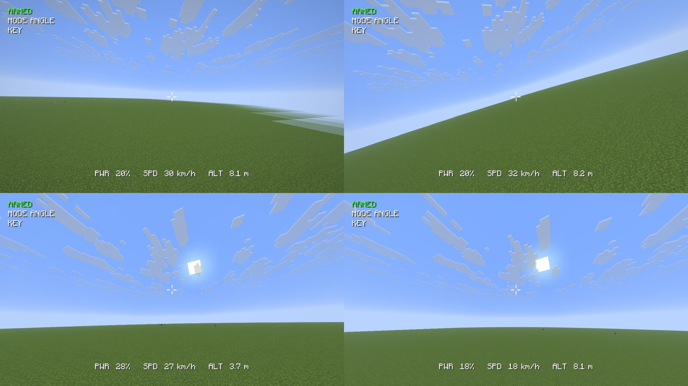

# Kamikaze Skies (working title)

A Minecraft (NeoForge) mod about flying FPV drones through a gritty, realistic, **fictional** battlefield: fly strike drones into vehicles, bunkers and buildings, watch them collapse, and survive an enemy that panics, hides and occasionally fights back.

Status: **Phase 1 done** (flying drone, FPV camera, keyboard/gamepad, tests). Read [`docs/DESIGN.md`](docs/DESIGN.md), [`docs/CONTROLS.md`](docs/CONTROLS.md) and [`docs/TESTING.md`](docs/TESTING.md).

- Single-player and AI first; co-op and PvP later.
- Keyboard, gamepad and touch controls are equal.
- Independent of OpenFPV and OpenComputers. GeckoLib is the only hard dependency.
- All Rights Reserved (private project).
