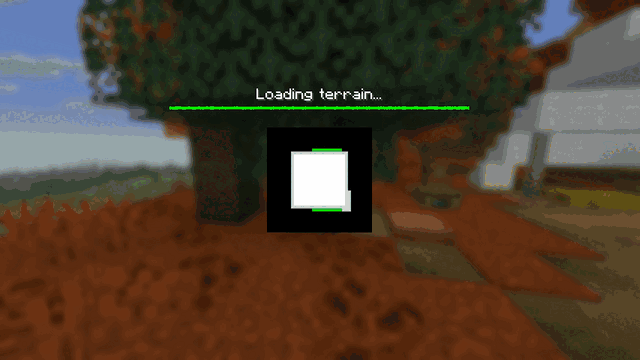
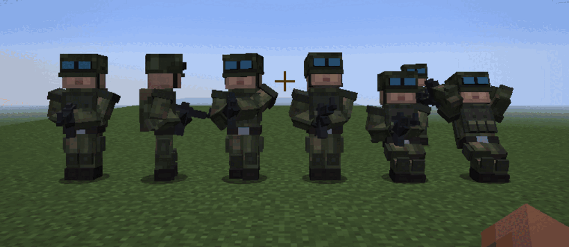
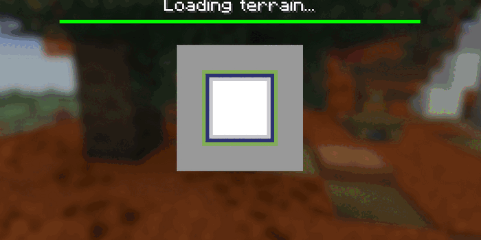
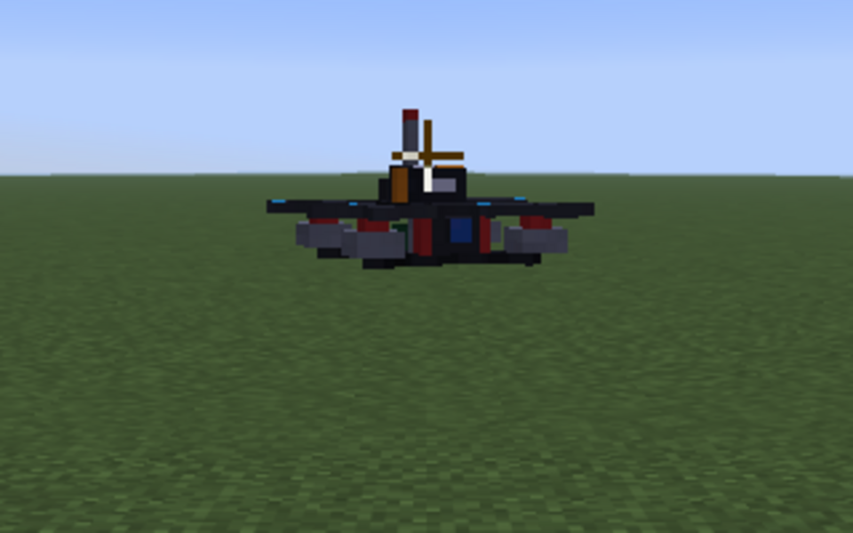
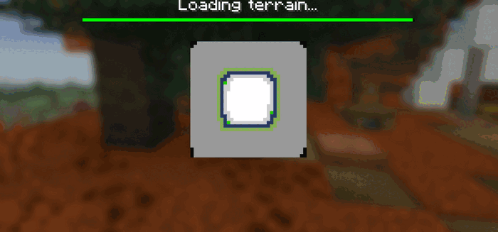
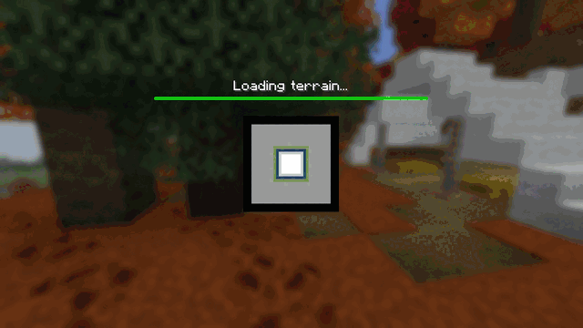

# Kamikaze Skies (working title)

A Minecraft (NeoForge) mod about flying FPV drones through a gritty, realistic, **fictional** battlefield: fly strike drones into vehicles, bunkers and buildings, watch them collapse, and survive an enemy that panics, hides and occasionally fights back.

Status: **Phase 4 done, Phase 5 in progress** (rifleman model with a full animation set is in the game; tank in too; drone model redone; **Phase 5 done, Phase 6 (enemy AI) done, Phase 7 (warzone dimension + missions) done**). Read [`docs/DESIGN.md`](docs/DESIGN.md), [`docs/ART_PIPELINE.md`](docs/ART_PIPELINE.md), [`docs/AI.md`](docs/AI.md), [`docs/MISSIONS.md`](docs/MISSIONS.md), [`docs/CONTROLS.md`](docs/CONTROLS.md), [`docs/DESTRUCTION.md`](docs/DESTRUCTION.md), [`docs/LINK_AND_BATTERY.md`](docs/LINK_AND_BATTERY.md), [`docs/CRAFTING.md`](docs/CRAFTING.md) and [`docs/TESTING.md`](docs/TESTING.md).

- Single-player and AI first; co-op and PvP later.
- Keyboard, gamepad and touch controls are equal.
- Independent of OpenFPV and OpenComputers. GeckoLib is the only hard dependency.
- All Rights Reserved (private project).
