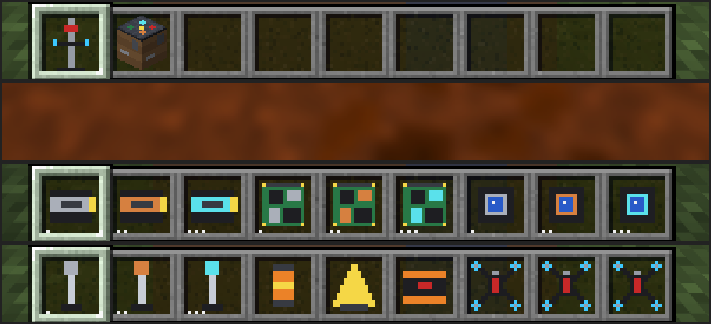

# Crafting and drone assembly

A drone is **assembled** from parts, so its performance comes from what you build, not from a fixed item.

## The parts
Seven tiered parts (tier 1 = basic, 3 = best; the little dots on each icon show the tier) plus two optional parts.

| Part | What it changes | Tier 1 / 2 / 3 |
|---|---|---|
| Frame | crash tolerance, weight | survives 8 / 10.5 / 13.5 m/s; 130 / 115 / 105 g |
| Motor set | thrust, current draw | 7 / 9 / 11.5 N per motor; 105 / 125 / 150 g |
| Propeller set | motor response, efficiency | 36 / 30 / 25 ms; draws 100% / 93% / 86% current |
| Battery pack (4S) | flight time, voltage sag, weight | 900 / 1300 / 1800 mAh; 85 / 140 / 200 g |
| Flight controller | stabilisation strength | gain x0.85 / 1.00 / 1.18 |
| FPV camera | field of view, clearer picture on a weak link | 95 / 105 / 115 degrees; +0 / +7 / +14 points of signal shown |
| Antenna | radio range | x0.6 / 1.0 / 1.8 of the configured range |
| Impact warhead (optional) | blast on impact | 160 g |
| Shaped-charge warhead (optional) | deep narrow jet | 200 g |
| Blackbox (optional) | records the last 30 s of flight | 15 g, needs a tier 2+ controller |

Every number is a game-balance value in `build/DroneBuild.java`. Test sweeps check that **every one of the 13,122 combinations**
is flyable (thrust-to-weight between 2.5 and 9.5, hover 2-30 minutes), so no build is a trap.

## Assembling a drone
Put one of each tiered part, plus an optional warhead and/or blackbox, in a crafting grid (a crafting table or the Drone
Workbench). Nothing else may be in the grid; two of the same part, two warheads, or a blackbox with a tier 1 controller do not
assemble. The result is an **FPV Drone** whose tooltip shows its parts, mass, thrust-to-weight and hover time.

Trade-offs the player feels: a big battery lasts longer but accelerates slower; a warhead adds weight; better motors draw
more current; a better camera shows a cleaner picture at the same signal; the antenna decides how far you can go.

Part recipes use vanilla materials (see `RECIPES.md`, generated): tier 1 is iron, copper and sticks, tier 2 adds redstone and
gold, tier 3 uses diamonds. The Drone Workbench is a crafting table with its own look.

## Losing a drone
A drone that crashes, is shot down, loses its radio link and falls, runs out of power, or detonates is **destroyed and its parts
are lost**. If it carried a **blackbox**, the blackbox is left behind (it survives crashes and detonations) with a flight log
(cause, flight time, top speed, max altitude, lowest voltage, weakest signal, and 30 s of telemetry). The summary shows in the
item's tooltip; a replay screen comes with the tablet UI in a later phase. A recovered blackbox is reusable as a part.

## Items
`/give` ids: `kamikaze_skies:part_<kind>_t<tier>` (`frame`, `motors`, `props`, `battery`, `flight_controller`, `camera`,
`antenna`), `part_warhead_impact`, `part_warhead_shaped`, `part_blackbox`, `drone_workbench`, `fpv_drone`, `jammer`.
The creative tab lists everything plus some preset drones.

## Implementation notes
- Pure Java: `build/DroneBuild` (stats, 17-bit encoding), `build/FlightRecorder`. Minecraft side: `PartItem`, `DroneAssemblyRecipe`
  (a `CustomRecipe`), `DroneWorkbenchBlock`, data components `drone_build` and `flight_log`.
- `scripts/gen_assets.py` generates the part icons, workbench textures and models, language entries, recipes and `RECIPES.md`.
- The build is stored on the drone item (component) and on the entity (synced), so pickup returns the same drone and the client
  knows the camera's field of view and signal bonus.
- The battery always starts full when a drone is placed (chargers and battery state on the item are future work).
