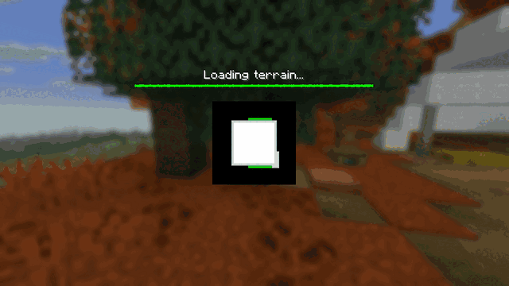
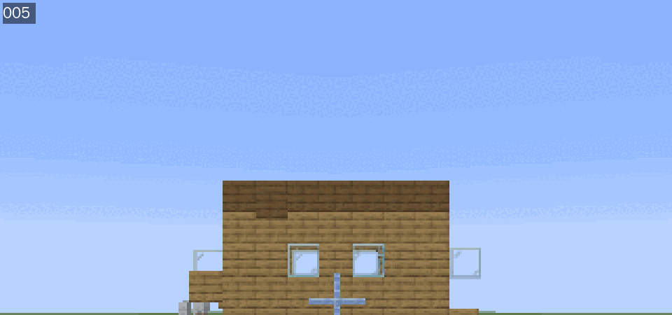

# Destruction systems (game design + tuning notes)

Everything here is game-balance tuning for a Minecraft mod, not a model of real munitions. Numbers are chosen for how
they play and feel, and are meant to be edited.

## Overview
A strike drone carries a **warhead** (`Warhead`: NONE, IMPACT, SHAPED), chosen when the drone is assembled (see `CRAFTING.md`). When an armed drone hits something faster than the
detonation speed (config, default 3 m/s), the warhead fires:

1. **Blast** (`BlastSolver`, pure Java): rays spread from the centre; each ray starts with some energy and loses it to
   distance and to the resistance of each block it passes. A block is removed if a ray still has energy when it reaches it.
   Hard blocks (obsidian) shield what is behind them; bedrock is never removed.
2. **Application** (`BlastExecutor`): blocks are removed in bulk, a capped number are thrown as debris, nearby entities are
   hurt and pushed, and particles/sound play.
3. **Collapse** (`SupportSolver` + `CollapseManager`): after any blast the surrounding structure is checked for blocks that
   lost their support; those fall.

## Profiles (`BlastProfile`)
| Profile | Feel | Shape |
|---|---|---|
| IMPACT | general-purpose, breaches light walls and throws debris | roughly spherical |
| SHAPED | narrow, deep, small collateral area | forward cone, capped range |

Parameters: `power` (ray energy), `airAttenuation`, `coneHalfAngle`, `maxRange`. Defaults live in `BlastProfile`.

## Structural stability (`SupportSolver`)
Blocks are classified by `MaterialClassifier`:
- **TERRAIN** (grass, dirt, sand, natural stone, ores, gravel, netherrack, bedrock...): anchors structures, never collapses.
- **STRUCTURE** (planks, bricks, cobblestone, glass...): carries load and can collapse.
- **AIR** (air, fluids, plants, leaves): ignored.

Support starts at 1.0 on terrain and decays as it spreads: little going up, a lot going sideways, in between for hanging
from above. Weaker materials (glass, wood) decay faster, so they span shorter gaps. A structure block with no path to the
ground that keeps support above zero falls. Rules of thumb with the default `Params`: columns stand ~80 blocks, a stone
overhang ~4 blocks, planks ~3, glass ~1; a 5x5 slab on a single column fails at its corners.

Structure on the edge of the analysed region is assumed to be supported from outside, so analysing a slice of a large
building never causes false collapses.

## Budgets and quality presets (`QualityPreset`)
| Preset | Rays | Blocks changed/tick | Falling blocks | Thrown debris | Analysis padding |
|---|---|---|---|---|---|
| LOW | 700 | 32 | 96 | 24 | 10 |
| MEDIUM | 1100 | 80 | 256 | 64 | 14 |
| HIGH | 1800 | 160 | 512 | 128 | 18 |

Config `destructionQuality` selects the preset. Collapses are applied a few blocks per tick, nearest the blast first, so a
failure spreads outward. Collapsing blocks become falling-block entities up to the cap; the rest crumble into dust.
The stability analysis runs on a worker thread against a snapshot; only reading the snapshot and applying results touch the
main thread.

## Config
- `destructionQuality` (LOW/MEDIUM/HIGH)
- `detonationSpeed` (m/s impact fuze threshold)
- `crashSpeed` (m/s at which an unarmed drone is destroyed)

## Known limits
- Falling blocks land as normal blocks (rubble) and are not re-analysed.
- No fire, no dust clouds beyond particles, no structure-aware sounds yet.
- Entity damage is a simple distance falloff; infantry/vehicle damage models come with the AI phase.
