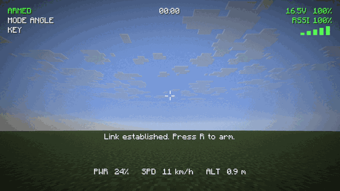
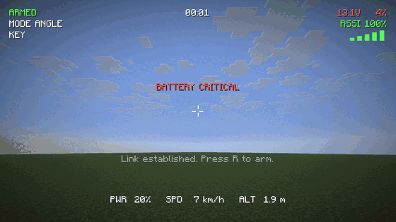

# Battery, radio link and the analog FPV feed




## Battery (`sim/Battery`)
A 4S LiPo model. Resting cell voltage follows a typical open-circuit curve (4.2 V full, 3.0 V empty); under load the pack
**sags** by `current x internal resistance`. Current comes from how hard the motors work (`Battery.currentFor`, rising
roughly with thrust^1.5). When the loaded cell voltage falls, the motors lose power (`powerScale`: full above 3.7 V, 0.7 at
3.3 V, 0.35 at 3.0 V, 0.1 at 2.9 V and below), so a weak pack cannot hold the same altitude at the same throttle.

| Pack | Capacity | Notes |
|---|---|---|
| `fourS1300` (default) | 1300 mAh | hovers about 7-8 minutes in the sim |
| `fourS2200` | 2200 mAh | longer flights (weight comes with drone parts in Phase 4) |

OSD: pack voltage and percent (yellow below ~12%, red and flashing below 5%), flashing LOW BATTERY / BATTERY CRITICAL, and
warning beeps (slow when low, fast when critical). Config `batteryEnabled` turns draining off for practice.

## Radio link (`sim/RadioLink`, `LinkMonitor`, `SignalLevel`)
Signal quality (0..1) is the product of:
- **distance**: full strength within 30% of the antenna's range, falling smoothly to zero at the range (`linkRangeBlocks`,
  default 400);
- **blocks in the way**: every metre of opaque blocks along the line multiplies the signal by `exp(-0.25)` (one block about
  0.78, four blocks about 0.37, eight about 0.14). The game samples at most 128 points per tick;
- **jammers**: each reduces the signal inside its radius (full inside the inner third, fading to zero at the edge); several
  combine like independent noise sources.

`LinkMonitor` smooths the signal (drops fast, recovers slowly) and derives:
- the video **signal level** (CLEAN, LIGHT_NOISE, NOISY, BREAKUP, HEAVY_BREAKUP, LOST) with hysteresis so the picture does not
  flicker between levels;
- **dropped control packets** when the signal is weak (the drone keeps its last command for that tick);
- the **failsafe**: after ~0.5 s below 4% signal the link counts as lost, the drone is disarmed and falls; it recovers after
  a few good ticks.

## Jammer (`JammerEntity`, item "Anti-Drone Jammer")
A mast with a 48-block field. Pick it up with sneak + use; any explosion near it destroys it. The model comes from the
Blockbench pipeline (`tools/blockbench/gen_jammer.py`).

## Analog video (`assets/.../shaders/post/fpv_analog.fsh`, `post_effect/`)
A post-process shader adds scanlines, colour bleed, grain, a rolling interference bar, horizontal tearing, a lens vignette,
and full-screen static when the link is lost. The OSD is drawn on top and stays crisp.
Post-effect uniforms are fixed when a chain loads and shaders have no clock, so `scripts/gen_fpv_post.py` generates 48
variants (6 signal levels x 8 noise phases) and the client switches phase every tick to animate the noise. Re-run the
script after changing the strength table in it. The effect is set through `LocalPlayer.setActivePostEffects`, because
`GameRenderer` rebuilds its own request list every frame.

## Training range
`/kamikaze training` (operators): builds a launch pad, a slalom of six gates (lime concrete, the last one red) and a wall with
a window to fly through, in the direction you are facing, and gives you a drone. Gates and the window are covered by a GameTest.

## Demos
```
scripts/make-demo-world.sh                                  # once
KS_DEMO_MODE=link    KS_START_DELAY=0 scripts/demo-screenshots.sh build/screenshots/link    250 80 0.4
KS_DEMO_MODE=battery KS_START_DELAY=0 scripts/demo-screenshots.sh build/screenshots/battery 250 70 0.5
```
Demos run in slow motion (5-10 TPS) so each state lasts several captured frames, and every run starts from a pristine copy
of the world.

## Known limits / next
- Antenna tiers and battery choices are not selectable yet; they arrive with drone crafting (Phase 4).
- Static and beep sounds are placeholder vanilla tones; real radio audio comes with the audio pass.
- "Freeze" is represented by heavy break-up and static, not a frozen frame.
