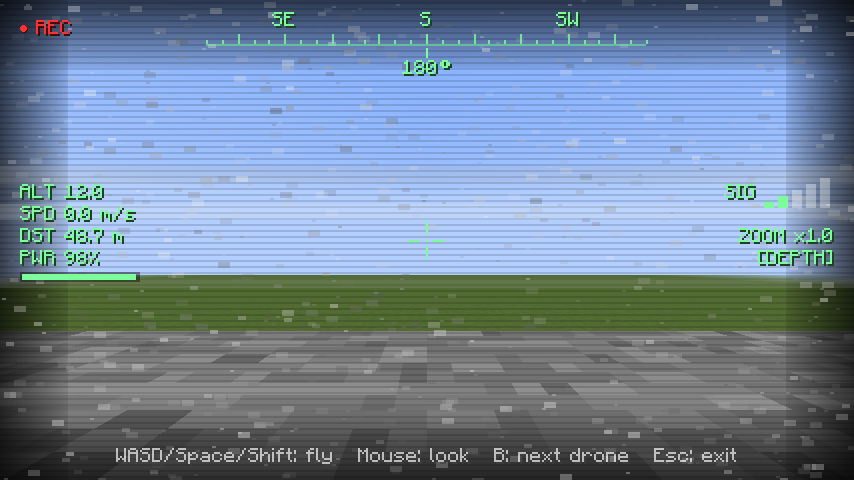

# OpenFPV

First-person-view cameras for **OpenComputers drones** — Minecraft 1.12.2 (Forge), built for
All the Mods 3 and any other pack with OpenComputers 1.7.5+ / 1.8.x.

Put a **Camera Upgrade** into a drone, switch the camera on from Lua, then press **V** to see the
world through the drone's eyes and fly it with the keyboard. Modules add night vision, zoom, a
gimbal, thermal vision and a depth sensor.

## Installing

Drop `openfpv-1.12.2-<version>.jar` into `mods/` next to OpenComputers. Single-player and
integrated-server play are what it was built and tested for; it also has proper client/server
packets, so a dedicated server with the jar installed on both sides should work.

## Screenshots

| | |
|---|---|
|  |  |
|  |  |

The module bay: 

## Items

| Item | What it does |
|---|---|
| **Camera Upgrade** | Drone upgrade (uses **one** upgrade slot). Adds the `camera` component. Right-click it to open its **module bay**. |
| **Night Vision Module** | `setNightVision()` – amplified green view |
| **Zoom Module** | `setFov()` / `setZoom()` |
| **Gimbal Module** | `setTilt()` / `setPan()` – aim the camera independently of the flight direction |
| **Thermal Vision Module** | `setThermal()` – heat-map vision, living things glow white-hot |
| **Depth Sensor Module** | `depth()` / `color()` – distance and colour grids for your Lua programs |

A Tier 1 drone only has two upgrade slots and a Tier 2 drone three, so modules do not take drone
slots: right-click the Camera Upgrade, drop modules into its five-slot bay, and the camera carries
them. Do this **before** assembling the drone — OpenComputers drones cannot be reconfigured after
they are built (the disassembler gives the upgrade back).

### Recipes

All recipes are shaped and use OpenComputers parts (`I` iron ingot, `G` glass pane, `R` redstone,
`P` printed circuit board):

| Item | Pattern | Special |
|---|---|---|
| Camera Upgrade | `IGI / RVR / IPI` | `V` = graphics card (tier 1) |
| Night Vision | `DGD / QCQ / IPI` | `D` glowstone dust, `Q` nether quartz, `C` advanced chip |
| Zoom | `GAG / ICI / IPI` | `A` gold ingot, `C` basic chip |
| Gimbal | `IXI / RCR / IPI` | `X` piston, `C` basic chip |
| Thermal | `BQB / GCG / IPI` | `B` blaze powder, `Q` quartz, `C` advanced chip |
| Depth Sensor | `ERE / LCL / IPI` | `E` ender pearl, `L` lapis, `C` advanced chip |

If a pack removes an OC part the recipe falls back to a vanilla stand-in and logs a warning.

## Flying

1. Build a drone with a CPU, RAM, an EEPROM and the Camera Upgrade, and make it run something like:

   ```lua
   local cam = component.proxy(component.list("camera")())
   cam.start()
   while true do computer.pullSignal(1) end
   ```

2. Stand within range of the drone and press **V**. (Keys can be changed in *Controls → OpenFPV*.)

| Key | Action |
|---|---|
| **V** | Enter / leave the FPV view (picks the nearest camera drone) |
| **B** | Cycle to the next camera drone |
| **W A S D** | Fly relative to where you look |
| **Space / Shift** | Up / down |
| **Mouse** | Look around |
| **Esc** | Leave FPV |

While flying, your body stands still (and is **not** protected — pick a safe spot). Your Lua
program keeps running and can still call `drone.move()` and friends; the keyboard simply sets
the drone's target while a key is held and makes it hover when you let go.

The view ends automatically if the camera is switched off, the drone is destroyed or unloaded,
or you get beyond the signal range. Static, scan lines and tearing grow as the signal weakens
(from half the range onwards).

### HUD

Crosshair, compass tape, altitude, speed, pilot distance, battery bar (flashes red under 15 %),
signal bars, zoom factor, active module tags and a blinking REC dot.

## Lua API — component `camera`

Methods marked *[module]* return `nil, "module not installed: …"` unless the module is in the bay.

| Method | Description |
|---|---|
| `start()` → `true` | Switch the camera on (fails with `nil, "no energy"` on an empty drone). |
| `stop()` → `true` | Switch it off; pilots are returned to their body. |
| `isActive()` → `boolean` | |
| `getRange()` → `number` | Max pilot-to-drone distance in blocks. |
| `getEnergyUsage()` → `number` | Energy per second while active. |
| `getModules()` → `table` | e.g. `{"nightvision","zoom"}` |
| `getHeading()` → `number` | Compass heading of the camera (0 = N, 90 = E), including gimbal pan. |
| `setNightVision(bool)`, `isNightVision()` | *[night vision]* |
| `setThermal(bool)`, `isThermal()` | *[thermal]* |
| `setFov(deg)`, `getFov()` | *[zoom]* field of view 10–110 (70 is normal) |
| `setZoom(x)`, `getZoom()` | *[zoom]* zoom factor up to 8× |
| `setTilt(deg)`, `getTilt()` | *[gimbal]* −90…90, positive looks **up** |
| `setPan(deg)`, `getPan()` | *[gimbal]* wraps at ±180, positive looks **right** |
| `centerGimbal()` | *[gimbal]* pan = tilt = 0 |
| `depth(w, h[, maxDist])` | *[depth]* rows (top→bottom) of distances in blocks, `-1` = nothing hit |
| `color(w, h[, maxDist])` | *[depth]* same grid, but the map colour (`0xRRGGBB`) of each block hit |

`depth`/`color` follow the camera's FOV, pan and tilt and the drone's facing, cost
`width × height × energyPerRay` energy and are limited to `maxWidth × maxHeight` rays per call.

```lua
local cam = component.proxy(component.list("camera")())
cam.start()
cam.setNightVision(true)
local rows = cam.depth(16, 8)            -- a tiny depth image
for y = 1, #rows do
  local line = {}
  for x = 1, #rows[y] do line[x] = rows[y][x] < 0 and "." or (rows[y][x] < 8 and "#" or "+") end
  print(table.concat(line))
end
```

## Configuration (`config/openfpv.cfg`)

| Option | Default | Meaning |
|---|---|---|
| `camera.maxRange` | 64 | Signal range in blocks (max 80: OpenComputers only syncs drone entities to clients within 80 blocks). On the client it is also capped at your render distance, because the world around the drone has to be loaded. |
| `camera.energyPerTick` | 0.1 | Energy the active camera draws from the drone per tick. |
| `flight.lead` | 4 | How far ahead of the drone the keyboard target is placed. |
| `depth.energyPerRay` | 0.02 | Energy per depth/colour ray. |
| `depth.maxWidth/maxHeight/maxDistance` | 32 / 16 / 64 | Scan limits. |
| `client.noise` | true | Static and scan lines on weak signal. |

## Building

Requires **JDK 8** (ForgeGradle 3 on Gradle 4.9 — the wrapper downloads Gradle itself).

```bash
./scripts/fetch-deps.sh                 # OpenComputers API + 1.8.x jar into libs/
JAVA_HOME=/path/to/jdk8 ./gradlew build # jar in build/libs/, runs the unit tests
```

The mod compiles only against OpenComputers' public API jar, so it is not tied to one OC version.

### Tests

* `./gradlew test` – JUnit tests for the camera maths (frames, grid rays, flight vectors, signal
  falloff, compass) and module bit-masks.
* **End-to-end self test** – boots a real 1.12.2 client with OpenComputers 1.8.x, builds a flat world,
  spawns real OC drones running real Lua, then drives the actual client: module bay GUI, entering FPV,
  keyboard flight, night/thermal/zoom/gimbal, depth scans checked against a wall at a known distance,
  OC's driver registry (Assembler acceptance), signal loss, Esc, camera cycling. It writes
  `run/autotest/summary.txt` and screenshots to `run/autotest/screenshots/` (73 checks).

  ```bash
  JAVA_HOME=/path/to/jdk8 ./scripts/run-selftest.sh
  ```

  It needs Xvfb and Mesa software rendering (`libgl1-mesa-dri`). Two environment quirks are handled
  for you: LWJGL 2 insists on the XRandR extension (`+extension RANDR`), and the ForgeGradle 3 dev jars
  for 1.12.2 contain a bad `Side.BUKKIT` enum constant that crashes *any* mod at start-up
  (see `scripts/fix-dev-side-enum.sh`). The harness lives in `com.openfpv.dev` and is not part of
  the released jar.

  Sample output is in `docs/screenshots/` and `docs/selftest-summary.txt`.

### Regenerating textures

`python3 scripts/gen_textures.py` redraws every icon and the GUI texture (no dependencies).

## License

MIT — see `LICENSE`.
