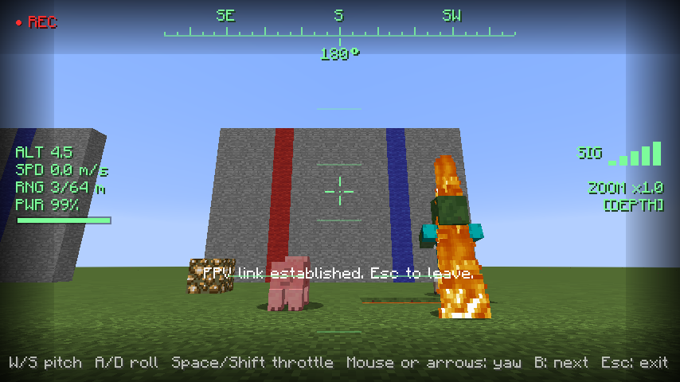
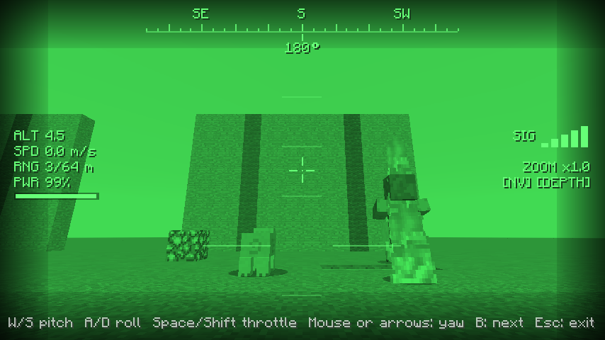
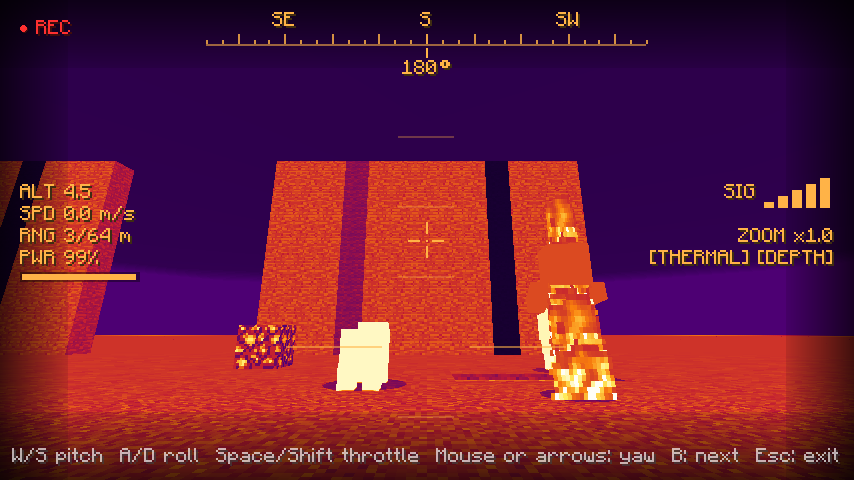
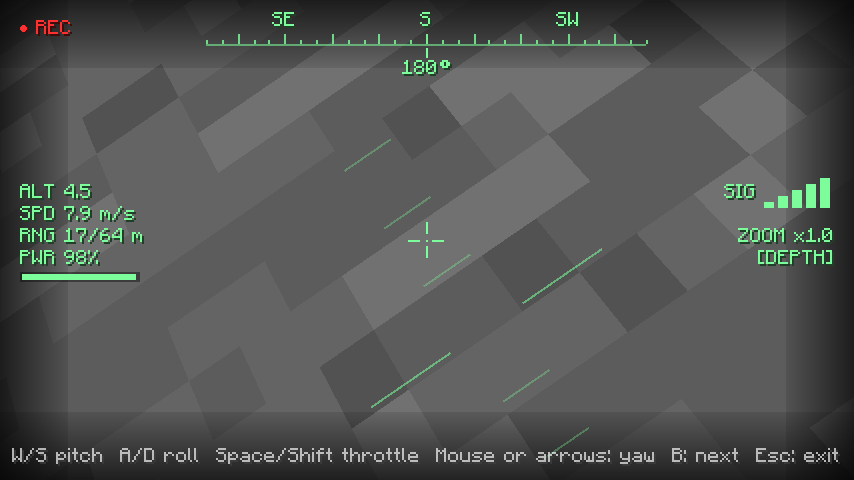
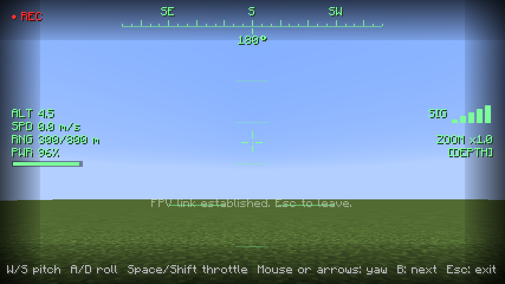
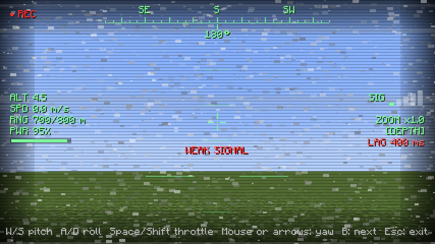
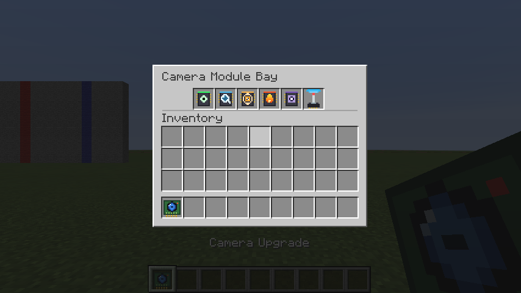

# OpenFPV

First-person-view cameras for **OpenComputers drones** — Minecraft 1.12.2 (Forge), built for
All the Mods 3 and any other pack with OpenComputers 1.7.5+ / 1.8.x.

Put a **Camera Upgrade** into a drone, switch the camera on from Lua, then press **V** to see the
world through the drone's eyes and fly it like a real quadcopter: tilt to accelerate, bank into
turns, glide, level out. Modules add night vision, zoom, a gimbal, thermal vision and a depth sensor,
and **Antennas** stretch the video link from 64 blocks to **1500+**, with chunks and mobs streamed to
you wherever the drone is.

## Installing

Drop `openfpv-1.12.2-<version>.jar` into `mods/` next to OpenComputers. Single-player and
integrated-server play are what it was built and tested for; it also has proper client/server
packets, so a dedicated server with the jar installed on both sides should work.

## Screenshots

| | |
|---|---|
|  |  |
|  |  |
|  |  |

Left to right: normal view, night vision, thermal, a right bank (the camera rolls with the drone),
a link 300 blocks out, and a link at 700 of 800 blocks (control lag, static, lost packets).

The module bay: 

## Items

| Item | What it does |
|---|---|
| **Camera Upgrade** | Drone upgrade (uses **one** upgrade slot). Adds the `camera` component. Right-click it to open its **module bay**. |
| **Night Vision Module** | `setNightVision()` – amplified green view |
| **Zoom Module** | `setFov()` / `setZoom()` |
| **Gimbal Module** | `setTilt()` / `setPan()` – aim the camera independently of the flight direction |
| **Thermal Vision Module** | `setThermal()` – heat-map vision, living things glow white-hot |
| **Depth Sensor Module** | `depth()` / `color()` – distance and colour grids for your Lua programs |
| **Antenna Mk1 – Mk4** | Goes in the bay's antenna slot and sets the video range: **160 / 400 / 800 / 1500** blocks (64 without one). Each tier is crafted from the previous one. |

A Tier 1 drone only has two upgrade slots and a Tier 2 drone three, so modules do not take drone
slots: right-click the Camera Upgrade, drop modules into its bay (five module slots plus the antenna slot), and the camera carries
them. Do this **before** assembling the drone — OpenComputers drones cannot be reconfigured after
they are built (the disassembler gives the upgrade back).

### Recipes

All recipes are shaped and use OpenComputers parts (`I` iron ingot, `G` glass pane, `R` redstone,
`P` printed circuit board):

| Item | Pattern | Special |
|---|---|---|
| Camera Upgrade | `IGI / RVR / IPI` | `V` = graphics card (tier 1) |
| Night Vision | `DGD / QCQ / IPI` | `D` glowstone dust, `Q` nether quartz, `C` advanced chip |
| Zoom | `GAG / ICI / IPI` | `A` gold ingot, `C` basic chip |
| Gimbal | `IXI / RCR / IPI` | `X` piston, `C` basic chip |
| Thermal | `BQB / GCG / IPI` | `B` blaze powder, `Q` quartz, `C` advanced chip |
| Depth Sensor | `ERE / LCL / IPI` | `E` ender pearl, `L` lapis, `C` advanced chip |

| Antenna Mk1 | `IRI / RWR / IPI` | `W` wireless network card (tier 1) |
| Antenna Mk2 | `GRG / RAR / GWG` | `A` Antenna Mk1, `G` gold ingot, `W` wireless card (tier 2) |
| Antenna Mk3 | `DCD / RAR / DWD` | `A` Mk2, `D` diamond, `C` T3 chip, `W` wireless card (tier 2) |
| Antenna Mk4 | `EQE / CAC / EWE` | `A` Mk3, `E` ender pearl, `Q` diamond chip, `C` T3 chip, `W` wireless card (tier 2) |

If a pack removes an OC part the recipe falls back to a vanilla stand-in and logs a warning.

## Flying

1. Build a drone with a CPU, RAM, an EEPROM and the Camera Upgrade, and make it run something like:

   ```lua
   local cam = component.proxy(component.list("camera")())
   cam.start()
   while true do computer.pullSignal(1) end
   ```

2. Stand within range of the drone and press **V**. (Keys can be changed in *Controls → OpenFPV*.)

### Quadcopter feel (angle mode)

The drone flies like a real quad in angle (self-levelling) mode. Your sticks command a **tilt**,
the drone tilts towards it with a little lag, and the tilted thrust is what accelerates it. So it
leans into every move, builds up speed, glides when you let go, and levels itself and coasts to a
stop. To brake, tilt the other way. The camera is bolted to the body (tilted up 15° like on a racing
quad), so it looks down as you lean forward and **rolls** in turns.

| Input | Action |
|---|---|
| **W / S** | Pitch forward / back |
| **A / D** | Bank left / right |
| **Space / Shift** | Throttle up / down |
| **Mouse left/right** or **← / →** | Yaw (turn) |
| **V** | Enter / leave the FPV view (picks the nearest camera drone) |
| **B** | Cycle to the next camera drone |
| **Esc** | Leave FPV |

While piloted the drone's speed cap is raised from OC's 8 m/s to about 20 m/s (config
`flight.speedMultiplier`) and its drag lowered so it can glide. Your Lua program keeps running
and can still call `drone.move()`; piloting simply takes over the drone's movement target while
you are flying, and it hovers when you leave. Your own body stands still (and is **not**
protected — pick a safe spot).

The view ends automatically if the camera is switched off, the drone is destroyed or unloaded,
or you get beyond the antenna's range.

### The control link

Static, scan lines and tearing start at half the range. With **control lag** on (default), your
inputs also arrive late and some are lost as the signal weakens, up to 500 ms of delay and 30 %
packet loss at the very edge, like real long-range flying. The HUD shows the current lag.

### Long range

With an antenna the drone can be hundreds of blocks away. Minecraft normally only sends you the
chunks and mobs around **yourself**, so while you are flying, OpenFPV streams the chunks around
the **drone** to you and makes the mobs near it visible too (config `longrange.*`). The terrain is
rendered up to 5 chunks around the drone.

> A drone only keeps running while its chunk is loaded. If you walk away from it (or fly a long
> way with no one near), give it an OpenComputers **chunkloader upgrade** and switch it on from Lua
> (`component.chunkloader.setActive(true)`), like any other far-away OC machine.

### HUD

Crosshair, artificial horizon, compass tape, altitude, speed, range, battery bar (flashes red
under 15 %), signal bars, control lag, zoom factor, active module tags and a blinking REC dot.

## Lua API — component `camera`

Methods marked *[module]* return `nil, "module not installed: …"` unless the module is in the bay.

| Method | Description |
|---|---|
| `start()` → `true` | Switch the camera on (fails with `nil, "no energy"` on an empty drone). |
| `stop()` → `true` | Switch it off; pilots are returned to their body. |
| `isActive()` → `boolean` | |
| `getRange()` → `number` | Max pilot-to-drone distance in blocks (set by the antenna). |
| `getAntennaTier()` → `number` | 0 = none, 1–4 = Antenna Mk1–Mk4. |
| `getEnergyUsage()` → `number` | Energy per second while active. |
| `getModules()` → `table` | e.g. `{"nightvision","zoom"}` |
| `getHeading()` → `number` | Compass heading of the camera (0 = N, 90 = E), including gimbal pan. |
| `setNightVision(bool)`, `isNightVision()` | *[night vision]* |
| `setThermal(bool)`, `isThermal()` | *[thermal]* |
| `setFov(deg)`, `getFov()` | *[zoom]* field of view 10–110 (70 is normal) |
| `setZoom(x)`, `getZoom()` | *[zoom]* zoom factor up to 8× |
| `setTilt(deg)`, `getTilt()` | *[gimbal]* −90…90, positive looks **up** |
| `setPan(deg)`, `getPan()` | *[gimbal]* wraps at ±180, positive looks **right** |
| `centerGimbal()` | *[gimbal]* pan = tilt = 0 |
| `depth(w, h[, maxDist])` | *[depth]* rows (top→bottom) of distances in blocks, `-1` = nothing hit |
| `color(w, h[, maxDist])` | *[depth]* same grid, but the map colour (`0xRRGGBB`) of each block hit |

`depth`/`color` follow the camera's FOV, pan and tilt and the drone's facing, cost
`width × height × energyPerRay` energy and are limited to `maxWidth × maxHeight` rays per call.

```lua
local cam = component.proxy(component.list("camera")())
cam.start()
cam.setNightVision(true)
local rows = cam.depth(16, 8)            -- a tiny depth image
for y = 1, #rows do
  local line = {}
  for x = 1, #rows[y] do line[x] = rows[y][x] < 0 and "." or (rows[y][x] < 8 and "#" or "+") end
  print(table.concat(line))
end
```

## Configuration (`config/openfpv.cfg`)

| Option | Default | Meaning |
|---|---|---|
| `range.tiers` | 64, 160, 400, 800, 1500 | Range in blocks with no antenna, then Mk1…Mk4. |
| `camera.energyPerTick` | 0.1 | Energy the active camera draws from the drone per tick. |
| `flight.maxTilt` | 35 | Maximum bank/pitch angle (degrees). |
| `flight.attitudeResponse` | 0.2 | How fast the drone reaches the commanded tilt (0.05 sluggish … 0.6 twitchy). |
| `flight.accelScale` | 0.12 | Horizontal acceleration (blocks/tick²) at 90° tilt; scaled by sin(tilt). |
| `flight.throttleAccel` | 0.05 | Climb/descend acceleration. |
| `flight.yawRate` | 4.5 | Turn rate (degrees/tick) at full input. |
| `flight.drag` | 0.9 | Velocity kept per tick while piloting (0.8 = OC default, higher = longer glide). |
| `flight.speedMultiplier` | 2.5 | Multiplier on OC's 8 m/s drone speed cap while piloting. |
| `flight.cameraUptilt` | 15 | Camera mounting angle (degrees up). |
| `link.controlLag` | true | Delay and drop control inputs as the signal weakens. |
| `link.maxLagTicks` / `link.maxPacketLoss` | 10 / 0.3 | Delay (ticks) and lost fraction at the edge of the range. |
| `longrange.streamRadius` | 5 | Chunk radius streamed around the drone (also capped by the server view distance). |
| `longrange.boostEntities` / `boostRadius` | true / 96 | Sync mobs near the drone to the pilot, and how far around it. |
| `depth.*` | 32×16, 64 | Depth/colour scan limits and cost. |
| `client.noise` | true | Static and scan lines on weak signal. |

## Building

Requires **JDK 8** (ForgeGradle 3 on Gradle 4.9 — the wrapper downloads Gradle itself).

```bash
./scripts/fetch-deps.sh                 # OpenComputers API + 1.8.x jar into libs/
JAVA_HOME=/path/to/jdk8 ./gradlew build # jar in build/libs/, runs the unit tests
```

The mod compiles only against OpenComputers' public API jar, so it is not tied to one OC version.

### Tests

* `./gradlew test` – 34 JUnit tests: camera maths (frames, grid rays, signal falloff, compass), the
  quadcopter physics (tilt → acceleration, attitude lag, angle wrapping, terminal speed), the control-link
  model (lag, ordering, packet loss) and module bit-masks.
* **End-to-end self test** – boots a real 1.12.2 client with OpenComputers 1.8.x, builds a flat world,
  spawns real OC drones running real Lua, then drives the actual client: module bay GUI, entering FPV,
  keyboard flight, night/thermal/zoom/gimbal, depth scans checked against a wall at a known distance,
  OC's driver registry (Assembler acceptance), the quadcopter model (tilt, speed, glide, levelling,
  banking, yaw), antenna ranges, a **pilot 300 blocks from the drone** (chunks and a mob streamed in),
  control lag and packet loss at 700 blocks, signal loss, Esc, camera cycling. It writes
  `run/autotest/summary.txt` and screenshots to `run/autotest/screenshots/` (101 checks).

  ```bash
  JAVA_HOME=/path/to/jdk8 ./scripts/run-selftest.sh
  ```

  It needs Xvfb and Mesa software rendering (`libgl1-mesa-dri`). Two environment quirks are handled
  for you: LWJGL 2 insists on the XRandR extension (`+extension RANDR`), and the ForgeGradle 3 dev jars
  for 1.12.2 contain a bad `Side.BUKKIT` enum constant that crashes *any* mod at start-up
  (see `scripts/fix-dev-side-enum.sh`). The harness lives in `com.openfpv.dev` and is not part of
  the released jar.

  Sample output is in `docs/screenshots/` and `docs/selftest-summary.txt`.

### Regenerating textures

`python3 scripts/gen_textures.py` redraws every icon and the GUI texture (no dependencies).

## License

MIT — see `LICENSE`.
